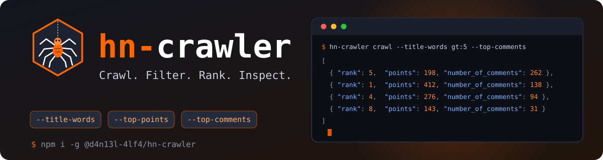

<p align="center">
  
</p>

<p align="center">
  <a href="https://www.npmjs.com/package/@d4n13l-4lf4/hn-crawler"></a>
  <a href="https://www.npmjs.com/package/@d4n13l-4lf4/hn-crawler"></a>
  
  
</p>

<h1 align="center">hn-crawler</h1>

<p align="center"><b>A tiny spider for News</b><br>
Crawl the top stories, slice them by title length, rank them by points or comments, and inspect every request.</p>

---

## Why a spider?

The front page of Hacker News is a goldmine, but a noisy one. `hn-crawler` is a small Node.js command-line tool that does three things well:

1. **Crawls** the top Hacker News stories and prints clean JSON.
2. **Filters** them by title word count (`gt:N` or `le:N`) and **ranks** them by points or comments.
3. **Reports usage**: every crawl is logged with a timestamp, the selected operations and how long it took.

---

## Installation

```bash
# Global install (gives you the `hn-crawler` command)
npm install -g @d4n13l-4lf4/hn-crawler

# ...or run it without installing anything
npx @d4n13l-4lf4/hn-crawler --help
```

Check that the spider is awake:

```bash
hn-crawler --version
```

---

## Quickstart

Three commands, thirty seconds:

```bash
hn-crawler crawl                                           # 1. grab the top stories
hn-crawler crawl --title-words gt:5 --top-comments         # 2. long titles, most discussed first
hn-crawler usage                                           # 3. see what you just did
```

---

## Walkthrough: from raw front page to ranked insights

Let's tell a small story. You want to know **which long-winded titles start the biggest arguments** and **which short, punchy titles collect the most upvotes**. Follow along: each step is a single command.

> Sample outputs below are illustrative: your titles and scores will differ, and the front page changes between runs. The field names and the usage table format are exactly what the tool prints.

### Step 1: Crawl the first 30 entries

Send the spider out. With no flags, `crawl` fetches up to the first 30 entries and prints them as JSON without filtering or ranking. The `rank` field is each entry's position on the front page.

```bash
hn-crawler crawl
```

Sample output (first 3 of 30 entries shown):

```json
[
  {
    "rank": 3,
    "title": "Why I stopped using microservices",
    "points": 301,
    "number_of_comments": 187
  },
  {
    "rank": 5,
    "title": "Ask HN: How do you manage side projects?",
    "points": 198,
    "number_of_comments": 262
  }
]
```

### Step 2: The talkers (more than five words, ordered by comments)

Long titles tend to be descriptive, and descriptive titles tend to start debates. Keep only entries whose title has **more than five words** (`gt:5`) and rank them by **number of comments** (`--top-comments`).

```bash
hn-crawler crawl --title-words gt:5 --top-comments
```

```json
[
  {
    "rank": 5,
    "title": "Ask HN: How do you manage side projects?",
    "points": 198,
    "number_of_comments": 262
  },
  {
    "rank": 1,
    "title": "Show HN: A tiny SQLite-backed job queue",
    "points": 412,
    "number_of_comments": 138
  },
  {
    "rank": 4,
    "title": "The unreasonable effectiveness of plain text files",
    "points": 276,
    "number_of_comments": 94
  },
  {
    "rank": 8,
    "title": "A visual guide to how CSS grid really works",
    "points": 143,
    "number_of_comments": 31
  }
]
```

### Step 3: The punchlines (five words or fewer, ordered by points)

Now flip it. Keep entries with **five words or fewer** (`le:5`) and rank them by **points** (`--top-points`).

```bash
hn-crawler crawl --title-words le:5 --top-points
```

```json
[
  {
    "rank": 2,
    "title": "Rust 2.0 is not happening",
    "points": 389,
    "number_of_comments": 301
  },
  {
    "rank": 3,
    "title": "Why I stopped using microservices",
    "points": 301,
    "number_of_comments": 187
  },
  {
    "rank": 6,
    "title": "Linux 7.0 released",
    "points": 187,
    "number_of_comments": 45
  },
  {
    "rank": 7,
    "title": "Postgres is enough",
    "points": 164,
    "number_of_comments": 120
  }
]
```

The two title-word rules are complementary: `gt:5` and `le:5` together cover every entry, with none in both lists.

### Step 4: Check the usage data

Finally, ask the tool what it did. Each request gets a unique **ID**, a **Request Date and Time** (shown in your local time zone), the **Applied Filters** and the **Duration** of the request.

```bash
hn-crawler usage
```

```text
ID                                   | Request Date and Time     | Applied Filters                                      | Duration (ms)
-------------------------------------+---------------------------+------------------------------------------------------+--------------
01a1efee-f1d6-7f30-b989-c03e4e02c6ec | 2026-11-18 19:32:56 (CET) | none                                                 | 249
01a1efee-f32f-75d6-92db-dcd225769067 | 2026-11-18 19:32:56 (CET) | sort:number_of_comments:desc,filter:title_words:gt:5 | 74
01a1efee-f5e6-75cb-ab5b-3a8fed5667d6 | 2026-11-18 19:32:57 (CET) | sort:number_of_points:desc,filter:title_words:le:5   | 75
```

Reading the table:

- **Row 1** is your plain `crawl`. No filtering or ranking was selected, so the applied operations are `none`.
- **Row 2** is the `gt:5` + comments request from step 2.
- **Row 3** is the `le:5` + points request from step 3.

That's the whole loop: **crawl, filter, rank, inspect.**

---

## CLI reference

```text
Usage: hn-crawler [options] [command]

A CLI tool to scrape and analyze Hacker News entries
```

### Global options

| Option          | Description               |
| --------------- | ------------------------- |
| `-V, --version` | Output the version number |
| `-h, --help`    | Display help for command  |

### Commands

| Command           | Description                              |
| ----------------- | ---------------------------------------- |
| `crawl [options]` | Crawl the top Hacker News stories        |
| `usage`           | Display current process usage statistics |
| `help [command]`  | Display help for a command               |

---

### `hn-crawler crawl`

Crawl up to the first 30 Hacker News stories. Title filtering and ranking are optional; the result is printed to stdout as a JSON array.

```bash
hn-crawler crawl [options]
```

| Option                 | Description                                  |
| ---------------------- | -------------------------------------------- |
| `--top-comments`       | Sort by number of comments, descending       |
| `--top-points`         | Sort by points, descending                   |
| `--title-words <rule>` | Filter by title word count: `gt:N` or `le:N` |
| `-h, --help`           | Display help for command                     |

With no crawl options, the command returns the first 30 available entries without filtering or ranking. With only a title-word rule, matching entries retain their source order. With only a ranking option, all retrieved entries are ranked by the selected metric. When both are specified, filtering happens before ranking.

**Title word rules**

| Rule   | Keeps entries whose title has... | Example              |
| ------ | -------------------------------- | -------------------- |
| `gt:N` | more than N words                | `--title-words gt:5` |
| `le:N` | N words or fewer                 | `--title-words le:4` |

`N` must be an integer from 1 through 10,000.

**Output fields**

| Field                | Type   | Description                             |
| -------------------- | ------ | --------------------------------------- |
| `rank`               | number | Position of the entry on the front page |
| `title`              | string | Entry title                             |
| `points`             | number | Points (upvotes)                        |
| `number_of_comments` | number | Number of comments                      |

**Examples**

```bash
hn-crawler crawl
hn-crawler crawl --top-points
hn-crawler crawl --title-words gt:5 --top-comments
hn-crawler crawl --title-words le:4
```

The crawl usage record describes selected operations as `sort:number_of_comments:desc`, `sort:number_of_points:desc`, or `filter:title_words:<rule>`. When neither filtering nor ranking is selected, it records `none`.

Real output of the last command:

```json
[
  {
    "rank": 5,
    "title": "Inside Deutsche Bank",
    "points": 350,
    "number_of_comments": 127
  },
  {
    "rank": 28,
    "title": "RFC 2675: IPv6 Jumbograms",
    "points": 24,
    "number_of_comments": 22
  },
  {
    "rank": 24,
    "title": "CrossPoint Reader",
    "points": 39,
    "number_of_comments": 16
  },
  {
    "rank": 2,
    "title": "Scottish HTTP Codes",
    "points": 110,
    "number_of_comments": 14
  }
]
```

---

### `hn-crawler usage`

Display usage statistics for your requests as a table.

```bash
hn-crawler usage
```

| Option       | Description              |
| ------------ | ------------------------ |
| `-h, --help` | Display help for command |

**Output columns**

| Column                  | Description                                                                                                                      |
| ----------------------- | -------------------------------------------------------------------------------------------------------------------------------- |
| `ID`                    | Unique identifier of the request                                                                                                 |
| `Request Date and Time` | When the request was made, as a local date and time, e.g. `2026-11-18 19:32:56 (CET)`                                            |
| `Applied Filters`       | Selected operations, e.g. `sort:number_of_points:desc,filter:title_words:le:5`; `none` when no filtering or ranking was selected |
| `Duration (ms)`         | How long the request took                                                                                                        |

---

## Contributing

Issues and pull requests are welcome. Clone the repo, run `npm install`, and send the spider out.

## License

See the `license` field on [npm](https://www.npmjs.com/package/@d4n13l-4lf4/hn-crawler).
